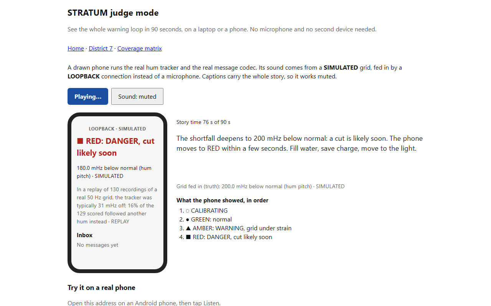
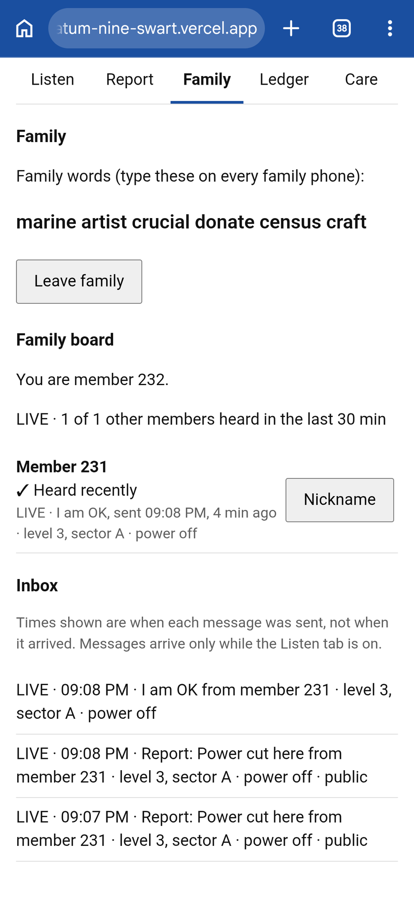

# STRATUM

[](https://github.com/royalgillz/stratum/actions/workflows/ci.yml)

**Live demo:** https://stratum-nine-swart.vercel.app/ · **Judge mode (90 s):** https://stratum-nine-swart.vercel.app/src/district/judge.html

| Judge mode, drawn phone at RED (SIMULATED) | Real phone, Galaxy Z Fold 7: a family OK arrived (LIVE) |
| --- | --- |
|  |  |

**Judge in 5 minutes:** play judge mode; open the coverage matrix's "Results at a glance"; read [docs/device-results.md](docs/device-results.md) and [docs/limits.md](docs/limits.md).

**Docs map.** For judges: [writeup](docs/writeup.md), [coverage](docs/coverage.md), [limits](docs/limits.md), [device results](docs/device-results.md). Process: [plan](docs/plan.md). Internal working notes: handoff, rung-test, spikes, intent/.

A citizen toolkit for the Hollow (Patriot HackFest Fall 2026, track "Life Underground") with one loop: hear, prove, pass on, share fairly. A phone hears the grid's hum sag before a power cut, passes short signed messages by sound with no network, and a fair-share rule divides what there is. District 7, a simulated district of 6 levels by 4 sectors, tests all of it against the Directorate's rule. The same physics holds wherever the network is shut down and power is rationed: a phone hears the hum and talks to the next phone by sound.

Write-up: [docs/writeup.md](docs/writeup.md).

## Try it

Live: https://stratum-nine-swart.vercel.app

1. **Judge mode** first, from the home page (`/src/district/judge.html`): the 90-second story with captions, no microphone, works muted.
2. **District 7** (`/src/district/`): a SIMULATED week under both rules side by side (Directorate left, STRATUM right), fifteen problems, a ledger panel that sends its digest by sound, and a **Stress week** built so STRATUM also loses.
3. **Coverage matrix** (`/src/district/coverage.html`): "Results at a glance", then each problem's tier, mechanism, 20-seed results, ablation and sweep charts, and the results against us.
4. **Phone page** (`/src/phone/`, Android Chrome, or scan the QR code on the home page): Listen (hum tiers, cut odds at AMBER and RED, fan-stop alert), Report (OK, power cut, HOLD WATER, ROUTE), Family, Ledger, Care.

Works offline: open the phone page once with network and it then opens and runs with none, and Chrome on Android can install it to the home screen (Add to Home screen) (tested on a Galaxy Z Fold 7: installed to the home screen, then opened and listened in Airplane mode). An update arrives on the next visit with network.

The Listen screen shows how the same hum tracker did on real grid recordings (ENF-WHU, REPLAY): median per-clip error 31.2 mHz, with 20 of 129 clips locked onto another tone. Tap "How sure is this?" for the per-clip and pooled medians.

On a real phone and laptop, follow the run sheet [docs/rung-test.md](docs/rung-test.md) (about 50 minutes, plus 15 for the fan test in Part I). Our results: [docs/device-results.md](docs/device-results.md).

## What is real

Every number on screen carries a label: **LIVE** (real device), **REPLAY** (real public recordings) or **SIMULATED** (District 7, and judge mode's drawn phone).

- Real code: the hum tracker, the 25-byte sound packets and their cryptography, the relay, the ledger and the allocator.
- Tested on a real phone (Galaxy Z Fold 7, Chrome 158, results in [docs/device-results.md](docs/device-results.md)): the shipped hum tracker went GREEN, AMBER, RED and NO HUM at 30 cm; the phone's signed family OK was verified by the District 7 gateway on a laptop at 30 cm, 1 m and 3 m (one send at each distance); a laptop tab's family OK reached the phone's family board. Earlier spikes T1 to T3 (spike code, [docs/spikes.md](docs/spikes.md)) measured the tracker's error and 20/20 packets at 1 m and 3 m. The phone passed a laptop tab's report on (one relay hop), installed to the home screen and opened and listened in Airplane mode. On the phone, a Breath Count danger sign gave RED and its medicine request by sound was verified by the District 7 gateway. A second session (Nov 20) passed on the phone: the 60-second tap count (AMBER at 47, GREEN at 35), the cut odds line on Listen at AMBER and RED, HOLD WATER and ROUTE alerts with their sender counts, District 7's tally of the phone's reports, a buzz at AMBER and RED (felt, but weak), the fan-stop alert with a real fan 3 m away (alert about 5 s after the stop), repeat OK sends (10 of 10 verified at 1 m and 10 of 10 at 3 m, no rejects) and the ledger digest by sound under the STRATUM rule (the laptop sent the digest of the SIMULATED ledger, fd297d64609f, and the phone's inbox showed the same 12 characters, packet LIVE). No iPhone was tested.
- Not yet passed on a phone: the longer vibration pulses (not retested). The cough counter failed its phone test (about 2 of 10 coughs counted) and is not shipped.
- Scored on real data (REPLAY): the tracker on 130 ENF-WHU grid recordings, the water detector on GECCO 2018.
- Simulated: District 7 and everything in it.

| Tier | Problems |
| --- | --- |
| Live (a part runs on a real phone) | 1 (power warning), 7 (messages without the network), 8 (families), 10 (Breath Count and the medicine request) |
| Modelled (algorithm in District 7 against the Directorate's rule) | 2, 3, 4, 5, 6, 9, 10 (delivery), 11, 12, 13, 14, 15 |
| Thin or Roadmap | none. The air half of problem 1 is a fan-stop alert on the phone, tested once with a real fan at 3 m |

The phone sends real reports for 2, 4, 5, 9 and 12. District 7 tallies the reports it hears for 2, 4, 5 and 9 by type and place, with the number of different senders (LIVE; tested with the phone's reports); food requests (12) are NEED messages, which the tally does not count. Each row, its metric, its value and its label: [docs/coverage.md](docs/coverage.md).

Headline (SIMULATED, seven-day week, 20 seeds): cuts warned 10 min ahead, Directorate 0.00, STRATUM 0.40 (the Directorate's rule issues no warnings, so its 0.00 is by rule; with Fair Share off, STRATUM warns 0.15); worst-decile served fraction, Directorate 0.66, STRATUM 0.85. Against us: in the stress week the warning gain is gone (0.00 under both), and from 3 lying surface crews in 5 the quorum carries the wrong band.

## Limits

The main ones (full list: [docs/limits.md](docs/limits.md)):

- District 7 is a simulation; its heat, water, disease, food and surface values are model outputs.
- Sound carries a few metres. Devices showed one hop at up to 3 m and one relay hop; multi-hop reach is simulated.
- Public alerts are not signed, and one sender can pose as several.
- Android only; no iPhone was tested. The fan alert was tested once on a phone, at 3 m, and District 7 scores air warnings only on scripted fan stops and an assumed share of listening phones.
- Case reports heard by sound are counted, not turned into an outbreak estimate (that needs a clinic list); the 60 s grid step cannot show the first seconds after a trip, so the grid-inertia sweep moves nothing; no on-device sound model is shipped (a cough counter failed its phone test).

## Run it

Node 24.

```
npm install
npm run dev          # local site
npm test             # unit tests
npm run typecheck
npm run check        # spec links, src/core rules, no em-dashes
npm run e2e          # Playwright on six viewports
```

## Reproduce the evidence

Every simulated number comes from the harness:

```
npm run harness -- --seeds 20                         # seven-day week, seeds 1 to 20, both rules -> public/evidence/seven-day.json
npm run harness -- --seeds 20 --script stress-week    # the stress week -> public/evidence/stress-week.json
npm run harness -- --seeds 20 --days 30               # 30 days -> public/evidence/30-day.json
npm run harness:ablations -- --seeds 20               # each engine switched off alone -> public/evidence/ablations.json
npm run harness:sweeps -- --seeds 20                  # one scripted stress varied at a time, both rules -> public/evidence/sweeps.json
```

Each file holds every seed's final value, the mean with a 95% interval (Student t) and the hourly mean, per rule and metric, all labelled SIMULATED. Costs shown beside a metric are under its `beside`. The files have no timestamp, so the same command writes the same bytes. `--check` adds the kernel's write checks (slower); `--out <path>` writes elsewhere.

An ablation switches one engine off: the adapters mapped to it run the Directorate's rule and the rest run STRATUM's (mapping in [docs/intent/adapters/adapters-design.md](docs/intent/adapters/adapters-design.md), "Ablations"). `ablations.json` holds the five conditions and each engine's contribution (STRATUM minus STRATUM without it, paired by seed, with a 95% interval). A sweep changes one event of the seven-day script and no model constant: lying surface crews 0 to 5, the depth of the deep shortfall, and the outbreak seed. Results and what goes against us: [docs/coverage.md](docs/coverage.md), "Ablations" and "Sweeps".

The two replays of real data (REPLAY). Fetch the ENF-WHU recordings first, as [data/README.md](data/README.md) says (the GECCO file is committed):

```
npm run score:enf     # tracker and its tiers on ENF-WHU, writes public/evidence/enf-whu.json
npm run score:gecco   # Witness detector on GECCO 2018, writes public/evidence/gecco.json
```

Both report figures that go against us: the tracker says NO HUM on 56.5% of readings that have hum, and the detector on all six water sensors raises about 159 false alarms a week.

## How it was built, licences

Built by one person, who made every decision and ran the device tests. No AI runs in the product. Code: MIT. Data: ENF-WHU (MIT), GECCO 2018 (CC BY 4.0, Moritz et al., DOI 10.5281/zenodo.3884398). ggwave: MIT.
