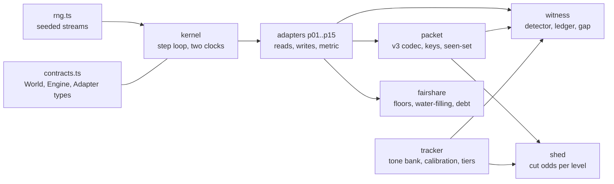

# High-Level Design: STRATUM core (`src/core`)

LID scope is `src/core/**`. The phone page, district page, audio adapters and harness import this core and are outside the arrow. Background and sources: `docs/plan.md`, `docs/handoff.md`.

## Problem

People in the Hollow cannot see a blackout coming, cannot trust the Directorate's numbers, lose the network on command, and are rationed by people who always cut the deep levels first. A tool for them must hear real signals, keep evidence nobody can quietly rewrite, pass messages without infrastructure, and divide scarce supplies by a rule anyone can check.

## Approach

One loop: **hear → prove → pass on → share fairly**, run by three engines over one simulated test district:

- **Witness**: one change detector plus one hash-chained ledger that stores each disputed quantity twice, measured and official. The gap is a metric.
- **Mesh**: one 25-byte authenticated packet (v3) carried by sound, with store-and-forward relay.
- **Fair Share**: one allocation rule for every scarce good: life floors first, then raise the worst-off (water-filling), and rotate what cannot be split through a debt memory.
- **Tracker** feeds Witness with the grid hum: a tone bank on the 800 Hz component gives relative deviation after calibration, then a tier.
- **Kernel** steps District 7 (6 levels × 4 sectors) so the engines can be scored against the Directorate's policy. Everything it produces is labelled SIMULATED.

## Target users

Residents with a phone (hear, report, check on family), the people who run a level's shared loads and stock (allocate), and judges reading the evidence (scores on real data, seeded comparisons).

## Goals

- The same core code runs on the phone, in the district worker and in Node, so what is scored is what is demoed.
- The tracker reports deviation within 5 mHz on a clean signal (spike T1 at 30 cm) and says NO HUM rather than guess.
- Packets authenticate, cannot be replayed as fresh, and hide which family sent them.
- Fair Share never breaches a floor while supply covers all floors, and states the breach when it cannot.
- Every simulated run is reproducible from its seed.

## Non-goals

No browser APIs, network, storage or randomness outside `rng.ts` in `src/core`. No language model. No claim that the core can seize breakers or prove the surface safe. No per-agent epidemic or 3D.

## Tenets

- **Honest over impressive.** When a result could be shown more strongly or more truthfully, show the truthful one: NO HUM, wide intervals, and published results that go against us.
- **Reuse an engine over adding one.** A new problem is configured from Witness, Mesh and Fair Share before any new mechanism is written.
- **Reproducible over realistic.** Prefer a simpler model that replays exactly from a seed over a richer one that does not.

## System design

| Component | Folder | Spec prefix | Serves problems |
| --- | --- | --- | --- |
| tracker | `src/core/tracker` | TRACK | 1 |
| packet | `src/core/packet` | PKT | 7, 8, and all reports |
| fairshare | `src/core/fairshare` | FAIR | 2, 3, 5, 6, 10, 11, 12, 14, 15 |
| witness | `src/core/witness` | WIT | 1, 4, 9, 13 |
| kernel | `src/core/kernel` | KERN | all modelled problems |
| shed | `src/core/shed` | SHED | 1, 2 |
| world models, adapters | `src/core/world`, `src/core/adapters` | *(not yet specified)* | 1 to 15 |

`contracts.ts` is the boundary every component compiles against. It changes only with the human's approval.

## Key design decisions

| Decision | Why | Alternative not taken |
| --- | --- | --- |
| Track the 800 Hz second harmonic, report deviation relative to a calibration | Phone microphones hear 800 Hz well; relative deviation cancels each device's clock offset (about ±13 mHz measured) | Absolute frequency: wrong by the device's clock error |
| 5-reading median over 0.5 s readings; calibration starts only once a full 2 s window holds the hum | Spike T1: median keeps the ramp within 4 mHz and still shows a 0.1 Hz step in 2.7 s | Longer smoothing: misses the 3 s step mark |
| Packet: HKDF keys from six generated words; tag, encrypted payload and 8-byte MAC in 25 bytes | Fits ggwave's 2–3 s budget; tag rotates every minute so listeners cannot follow a family | Signatures per packet: too many bytes |
| Fair Share as leximin water-filling with floors | One explainable rule for all goods; proportional scaling when floors cannot all be met | Proportional to demand: favours the already-supplied |
| One seeded generator, separate named stream per module | Adding a module does not change other modules' draws | `Math.random`: runs are not reproducible |

## Success metrics

Tracker error in mHz and NO HUM accuracy on ENF-WHU clips (REPLAY). Packet success at 1 m and 3 m (LIVE). Worst-decile served fraction and floor-breach person-days, 20 seeds against the Directorate policy (SIMULATED). Detector precision and recall on GECCO 2018 (REPLAY). Broken if: a floor is breached while supply covers all floors, a replayed packet shows as fresh, or a seed fails to reproduce its run.

## References

`docs/plan.md` (mechanisms, formulas, sources), `docs/handoff.md` (contracts, packet layout), `docs/spikes.md` (T1–T3 results), `docs/params.md` (every parameter and its source), `docs/limits.md`.
